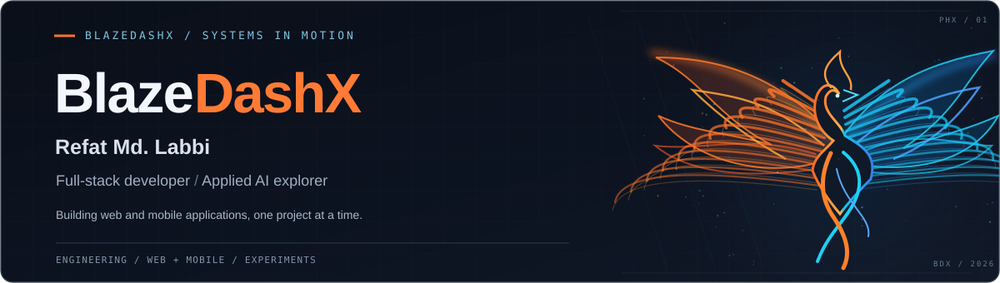
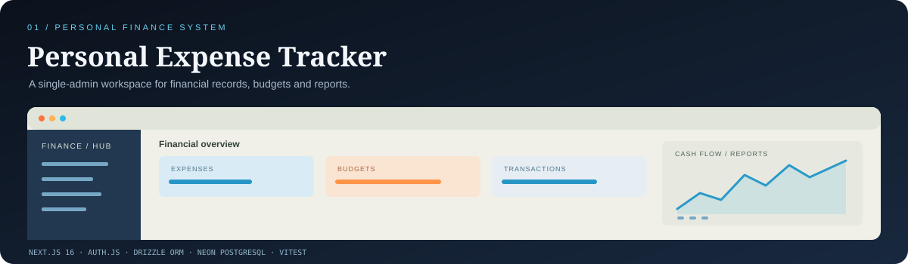
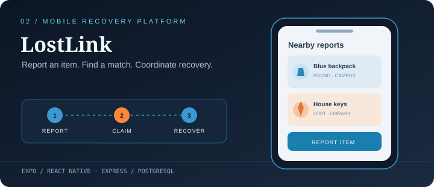
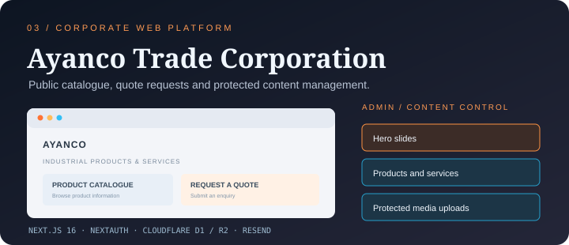
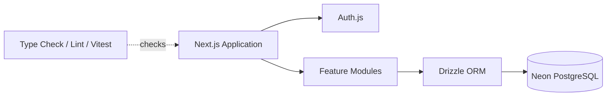
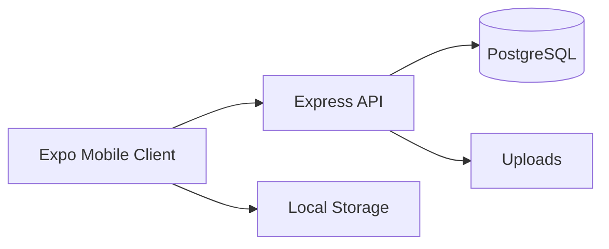
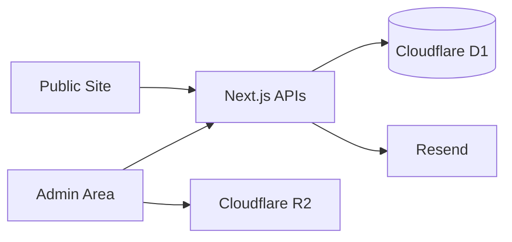
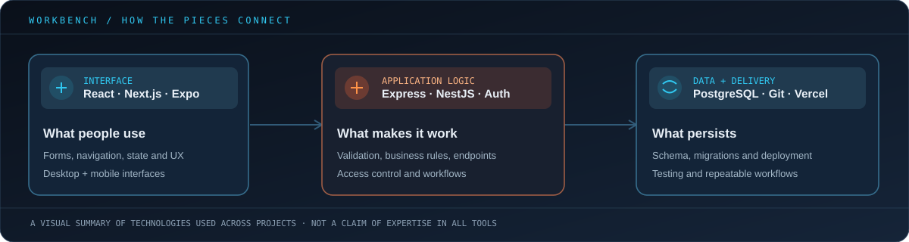

DEVELOPMENT SYSTEMS · PRACTICAL PRODUCTS · LEARNING IN PUBLIC

  

<a href="#about">ABOUT</a> &nbsp; / &nbsp;
<a href="#selected-work">PROJECTS</a> &nbsp; / &nbsp;
<a href="#engineering">ENGINEERING</a> &nbsp; / &nbsp;
<a href="#live-signal">LIVE SIGNAL</a> &nbsp; / &nbsp;
<a href="#connect">CONNECT</a>

  

---

## 01 / About

I'm **Refat Md. Labbi**, a Computer Science undergraduate based in **Dhaka, Bangladesh**. I work on full-stack web applications, mobile interfaces, and the services that connect them. My current learning interests are **LLM integration, system design, and machine-learning fundamentals**.

I like software that feels considered at both ends: clear interfaces for people using it, and understandable systems for people maintaining it.

| CURRENT DIRECTION | PRACTICAL EXPERIENCE | AVAILABLE FOR |
| :--- | :--- | :--- |
| Full-stack web and mobile development | React, Next.js, Express, PostgreSQL | Internships and software collaborations |

## 02 / Selected systems

**A closer look at the work, rather than a wall of repository badges.** These are selected public repositories; project illustrations are designed summaries, not deployment screenshots.

### Personal Expense Tracker

A single-admin financial workspace for managing expenses, budgets, transactions, reports, calendar activity, and personal records. The repository includes a verification workflow covering type-checking, linting, tests, and builds.

**Technical focus:** Next.js 16, React 19, Auth.js v5, Drizzle ORM, Neon PostgreSQL, Tailwind CSS 4, Vitest.

**What to inspect:** the authenticated workspace, domain-specific feature modules, database schema, reporting features, and verification scripts. [Explore source](https://github.com/BlazeDashX/Personal-Expense-Tracker).

<table>
<tr>
<td width="50%" valign="top">

### LostLink

A lost-and-found app connecting reports, item discovery, claims, and recovery conversations. The mobile client and backend use separate application layers.

**Stack:** Expo, React Native, TypeScript, Express, PostgreSQL; optional Cloudinary uploads.

[Explore source](https://github.com/BlazeDashX/LostLink)

</td>
<td width="50%" valign="top">

### Ayanco Trade Corporation

A corporate site with product and service catalogues, quote requests, an administrative interface, and CMS-managed content.

**Stack:** Next.js 16, NextAuth, Cloudflare D1/R2, Resend.

[Explore source](https://github.com/BlazeDashX/Ayanco-frontend)

</td>
</tr>
</table>

**More repositories:** [Learning Platform frontend](https://github.com/BlazeDashX/Learning_Platform_frontend) · [Backend](https://github.com/BlazeDashX/Learning_Platform) · [Crown Clothing](https://github.com/BlazeDashX/crown-clothing-nextJS) · [A-05 Emergency Hotline](https://github.com/BlazeDashX/A-05-Emergency-Hotline)

<b>OPEN THE ENGINEERING FILES / architecture notes</b>

#### 01. Expense Tracker: product-to-database flow

Feature-based application structure, credentials authentication, data persistence through Drizzle ORM, and automated checks using the repository's scripts.

#### 02. LostLink: mobile-to-service flow

Expo/React Native client, Express endpoints for users/items/claims/conversations, and PostgreSQL records.

#### 03. Ayanco: public site and content administration

Public website and a protected administrative area for content workflows, with Cloudflare services for data/media and Resend for outgoing messages.

## 03 / Engineering workbench

**Technologies I use or study**

| AREA | LANGUAGES AND TOOLS |
| :--- | :--- |
| Web interfaces | JavaScript, TypeScript, React, Next.js, Tailwind CSS |
| Services and data | Node.js, Express, NestJS, PostgreSQL, MongoDB |
| Mobile applications | React Native, Expo |
| AI/ML exploration | Python, PyTorch, LLM API integration |
| Engineering workflow | Git, GitHub, VS Code, Docker, Vercel, Postman, Figma |

<b>OPEN THE WORKBENCH / what I'm learning and practicing</b>

- **Application structure:** separating UI state, application logic, services, and persistence.
- **Authentication and access:** studying authentication flows and protected application areas.
- **Data modelling:** relational schemas, queries, and changes to stored data.
- **Testing and delivery:** applying repeatable checks where projects support them.
- **Applied AI:** exploring how LLM APIs and ML pipelines fit into useful software.

These are areas of practice, not a claim of equal expertise in every technology.

## 04 / Live engineering signal

The graphics below refresh automatically from **public GitHub data** after Phoenix Profile Autopilot is enabled. They are generated by a scheduled workflow inside this profile repository, not hard-coded pictures.

### The repository constellation

A custom data-driven map of recently pushed public repositories. Node labels and sizes update from the GitHub API; connecting lines indicate membership in this portfolio, not software dependencies.

### Development pulse

### Recent change log

<b>OPEN THE DATA ROOM / repository radar and language footprint</b>

**Recently pushed public repositories**

**Primary languages across owned public repositories**

*Language counts measure public repositories, not skill level or lines of code. Recent events only cover the public event feed's recent window, and do not include private activity.*

<b>OPEN THE CONTRIBUTION TRACE / animated activity graph</b>

<picture>
  <source media="(prefers-color-scheme: dark)" srcset="./assets/live/snake-dark.svg" />
  
</picture>

## 05 / Connect

**Portfolio:** [refatmdlabbi.vercel.app](https://refatmdlabbi.vercel.app/)  
**Email:** [refat00021@gmail.com](mailto:refat00021@gmail.com)  
**GitHub:** [@BlazeDashX](https://github.com/BlazeDashX)

---

PHOENIX / BUILD · VERIFY · ITERATE · REPEAT

